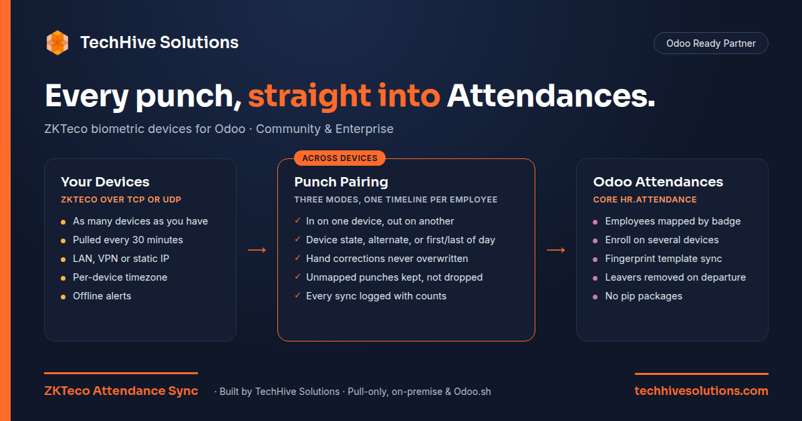
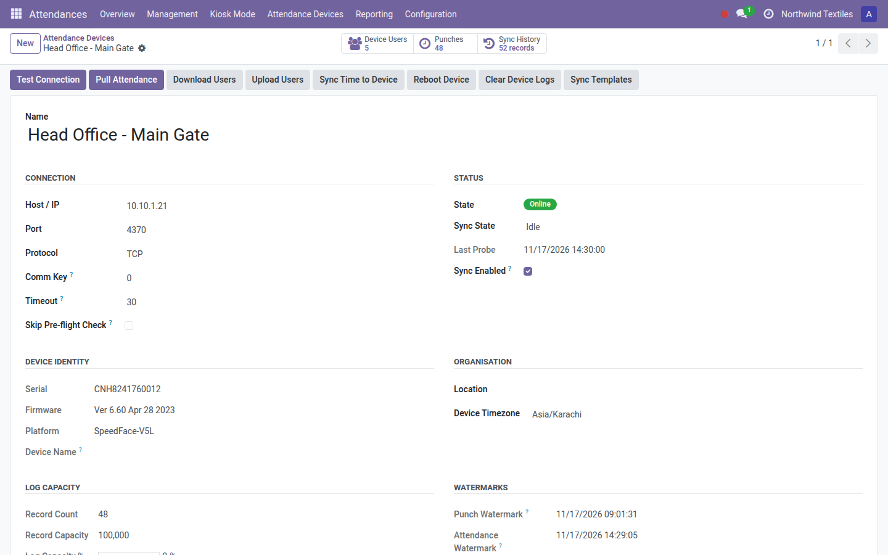
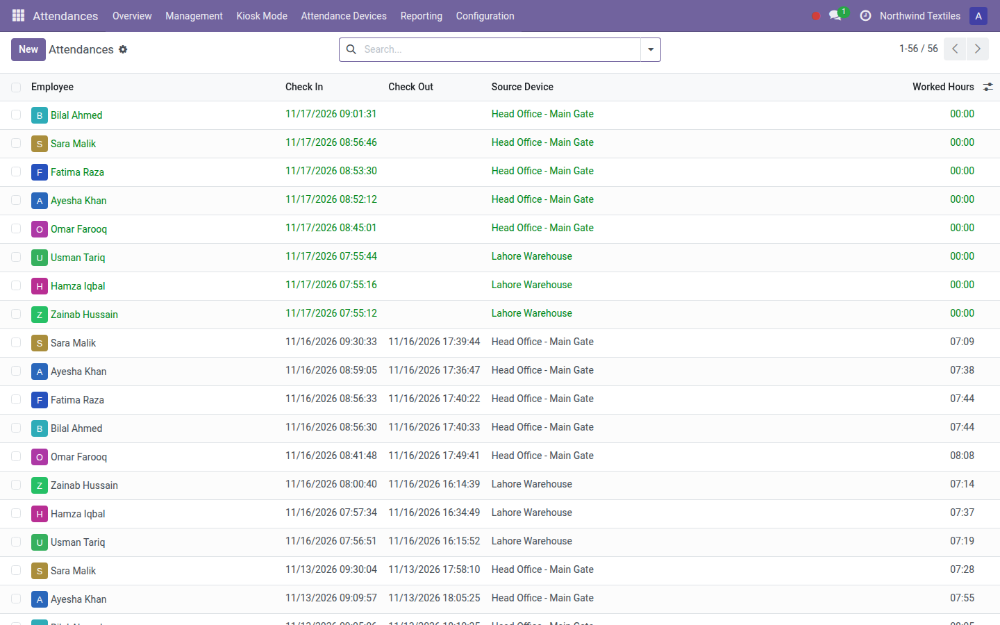
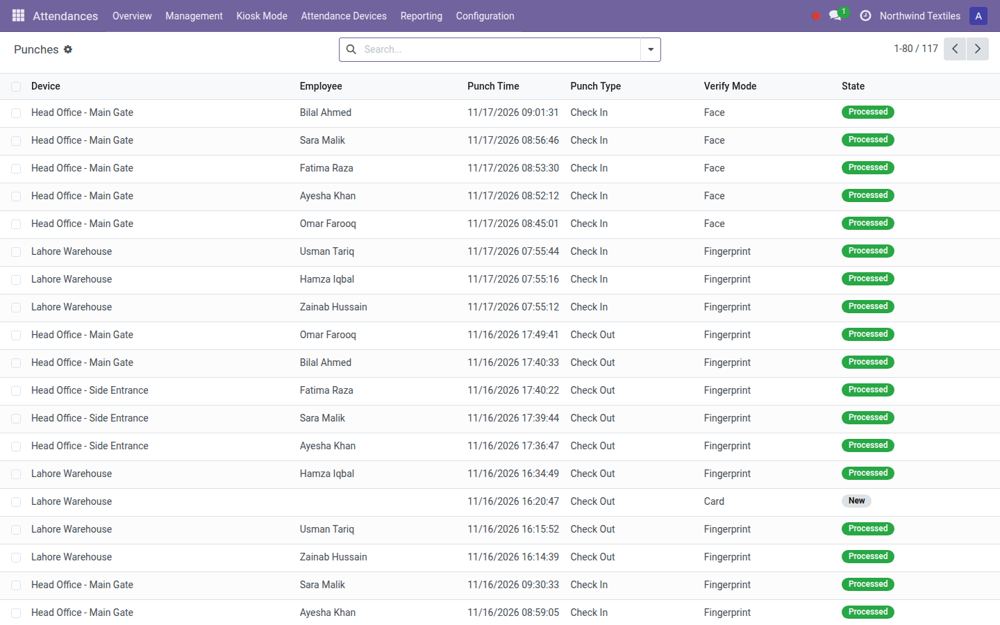
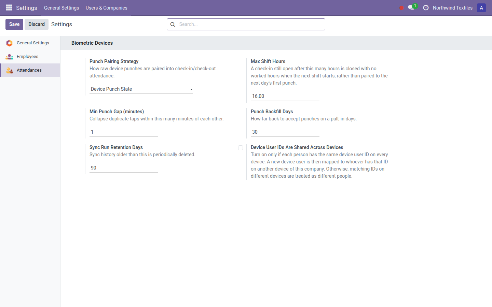
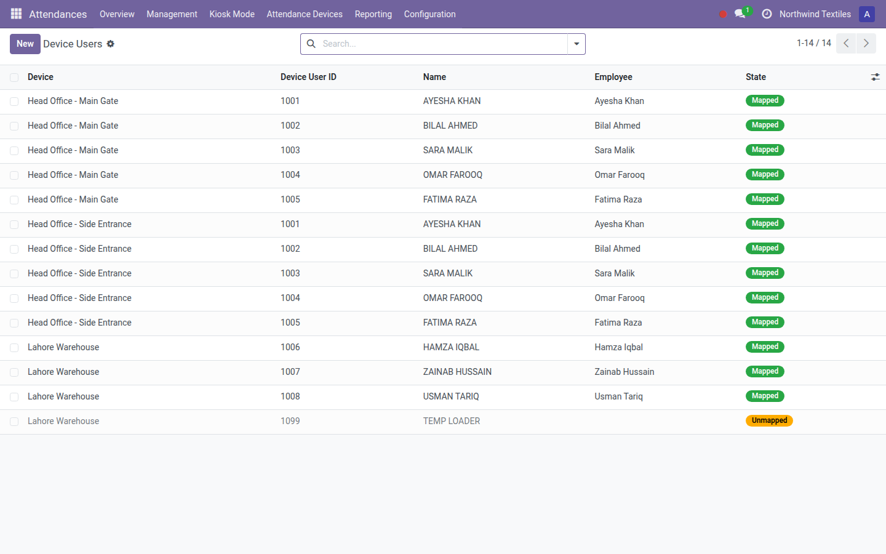
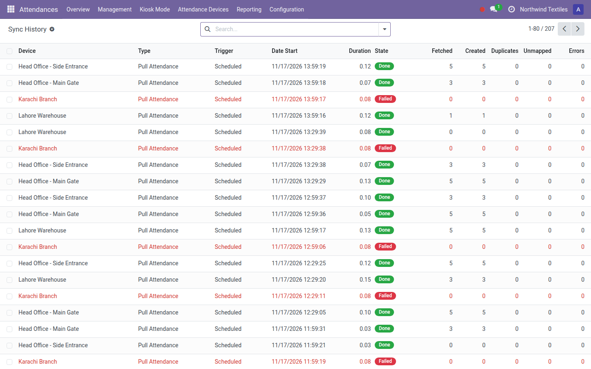

  

<h1 align="center">ZKTeco Attendance Sync</h1>

  Every punch from your ZKTeco biometric devices, straight into Odoo Attendances. Check in on one device, check out on another, and get one attendance, not two.

  
  
  

  <a href="https://apps.odoo.com/apps/modules/18.0/th_biometric_attendance">
    <b>⬇&nbsp;&nbsp;Get it on Odoo Apps</b>
  </a>

---

## Overview

Pull attendance from as many ZKTeco devices as you have, every 30 minutes or on demand, and turn the punches into ordinary Odoo attendances. Each pull pairs the punches from all your devices together, in time order, so an employee has one timeline wherever they tapped.

The module connects to each device over TCP or UDP. The device must be reachable from your Odoo server: on your LAN, over a VPN, or at a static IP. Nothing to install besides the module, and installing it contacts no device until you add one.

## Features

- 🖐️ **Every device, one timeline**: each pull pairs punches from all devices together, so check in on one and out on another.
- 🔀 **Three pairing modes, per company**: the device's own check-in/check-out state, alternate in and out for single-button devices, or first and last punch of the day.
- ✍️ **Hand corrections stay**: once someone edits a device attendance, pairing never changes it again.
- 👥 **People mapped, nobody dropped**: device users are linked to employees by badge number, or by name when exactly one employee matches. A punch from an unmapped person stays visible until you map them.
- 🔁 **Enroll once, use everywhere**: enroll an employee on several devices with the same device ID, and copy fingerprint templates from one device to the others. Each template is read back, so a device that didn't store it is reported.
- 🚪 **Leavers lose access**: registering a departure removes the employee from every device.
- 📡 **Offline alerts**: a connectivity check every 5 minutes gives device managers an activity when a device drops, and a note when it is back.
- 🕒 **Right time, everywhere**: a timezone per device, and punches dated in the future are set aside for review. **Sync Time** fixes the clock.
- 🛡️ **Safe to run**: two roles, a guarded log clear, protected device attendances, and devices pulled in parallel, each with its own timeout.
- 📜 **Sync history**: every pull, upload and clear leaves a record with its counts and any error.

## Screenshots

### A device

Its connection, serial, firmware and timezone, with buttons to pull, sync the time, reboot and clear logs.

  

### Ordinary Odoo attendances

Each with the device it came from.

  

### Every raw punch kept

With how it was verified: fingerprint, face or card.

  

### Pairing rules, set per company

  

### People on the devices

Mapped by badge number; anyone unmapped stays in view.

  

### Every sync on record

Including the one that failed.

  

## Comparison

|                                          | Typical ZKTeco connector | ZKTeco Attendance Sync |
| ---------------------------------------- | :----------------------: | :--------------------: |
| Pull punches into Odoo Attendances       |            ✓             |           ✓            |
| In on one device, out on another         |            –             |           ✓            |
| Three pairing modes, per company         |            –             |           ✓            |
| Hand corrections never overwritten       |            –             |           ✓            |
| Fingerprint template sync across devices |            –             |           ✓            |
| Leavers removed from every device        |            –             |           ✓            |
| Offline alerts and sync history          |            –             |           ✓            |
| No Python packages to install            |            –             |           ✓            |

## What it doesn't do

- It pulls from devices; it doesn't accept device push (ADMS / iclock).
- It doesn't run on Odoo Online (SaaS), which can't reach a device on your network. You need Odoo.sh or your own server.
- Face templates aren't copied between devices yet; fingerprints are.
- It doesn't decide present, absent or overtime. Punches become attendances, and Odoo does the rest.

## Devices

ZKTeco standalone terminals that speak the ZK protocol on port 4370, over TCP or UDP.

Works with: ZKTeco K40 / K40 Pro, F18, MB160, MB460, iFace 702, uFace 800 and SpeedFace-V5L.

Not sure about yours? Email us the model and firmware before you buy, and we'll tell you.

## Documentation

- [Setup guide](docs/setup-guide.md): install, add your first device and test the connection.
- [Admin guide](docs/admin-guide.md): pairing rules, device users, enrolling, template sync, roles and troubleshooting.
- [Changelog](docs/CHANGELOG.md)

## Pricing & Versions

|                   |                                                                                        |
| ----------------- | -------------------------------------------------------------------------------------- |
| **Price**         | $99 USD                                                                                |
| **Odoo versions** | 18.0 (Community and Enterprise)                                                        |
| **License**       | OPL-1                                                                                  |
| **Covers**        | All your own databases on one Odoo version: production, staging and test               |
| **Get it**        | [Odoo Apps listing](https://apps.odoo.com/apps/modules/18.0/th_biometric_attendance)   |

## Support

Built by **TechHive Solutions**, a certified Odoo Partner. We build AI integrations, ERP setups, custom Odoo plugins, and enterprise apps.

Need help connecting your devices, or a VPN to a branch? Setup and customisation cost $29/hour. Want to see it first? Book a 15-minute demo by email.

- 🌐 [techhivesolutions.com](https://techhivesolutions.com)
- ✉️ [info@techhivesolutions.com](mailto:info@techhivesolutions.com)

## License

The module is distributed under **OPL-1** via [Odoo Apps](https://apps.odoo.com/apps/modules/18.0/th_biometric_attendance). Content in this repository © TechHive Solutions. Source code is not included here.
